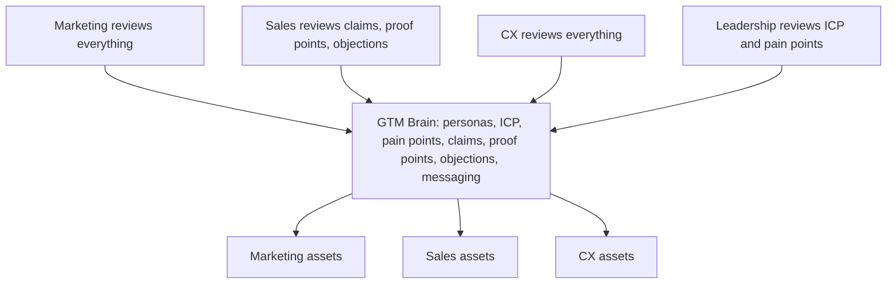

# GTM Brain: one reviewed source of truth for Marketing, Sales and CX

> A write-up of a system I built at a two-sided mental-health marketplace. It ran inside company systems, so the code isn't public.

Marketing, Sales and customer experience (CX) each worked from their own assumptions about the market. I built GTM Brain, a shared go-to-market (GTM) context layer: a reviewed source of personas, claims, proof points and approved messaging that the teams and their AI tools all drew from. The headline result: asset creation time down 30%.

[Read the full write-up](docs/README.md)

## The problem

Market intelligence (personas, differentiators and competitor benchmarks) sat scattered across static documents. Marketing, Sales and CX each worked from different assumptions about the market.

That gap matters more once teams draft with AI. Every team's AI tools need the same context, or their drafts disagree. What was missing was a shared, reviewed source of context that the people and their AI tools could all draw from.

## How it works

- **What it held.** Personas, the ideal customer profile (ICP), pain points, claims, proof points, objections and approved messaging.
- **Where it lived.** A GitHub repository.
- **Who reviewed it.** Marketing, Sales, CX and Leadership each reviewed all or part of it, shown in the next section.
- **Who drew from it.** Marketing drew on it for assets, Sales for messaging and CX for resources.
- **Their AI tools drew from it too.** Each team's AI tools worked from the same reviewed context as the people, so an AI draft started from the same approved claims and messaging.

## Where people stay in the loop

Every part of GTM Brain had human reviewers. It was reviewed by four teams (Marketing, Sales, CX, Leadership):

| Team | What it reviewed |
|---|---|
| Marketing | Everything |
| Sales | Claims, proof points and objections |
| CX | Everything |
| Leadership | The ICP and pain points |

The teams' AI tools drew from this reviewed content, the same as the teams did, so people set the context the AI worked from.

## Results

The headline result: asset creation time down 30%.

## Stack

GitHub · read by the team's AI tools

## What I'd change

- **Link each asset to the claims it used.** Teams built their assets, messaging and resources from GTM Brain. I'd record which claims and proof points each asset used, so when a claim changes, it's clear what needs an update.
- **Name a lead reviewer for each part.** Marketing and CX each reviewed everything. I'd give each part a lead reviewer, so it's clear who answers for it.
