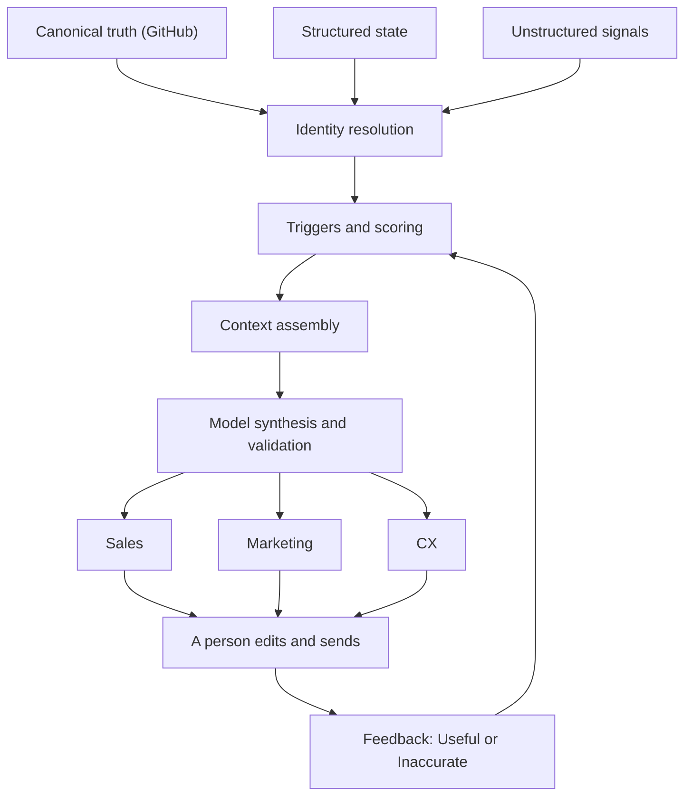

# Overview

> A write-up of a system I built at a two-sided mental-health marketplace. It ran inside company systems, so the code isn't public.

This page is the retrospective product requirements document (PRD) for GTM Brain: the business it served, the problem, what I set out to build, the principles it followed and the decisions behind it.

## Summary

GTM Brain was a shared go-to-market (GTM) context layer. Its core was the company's canonical truth: a reviewed GitHub repository of the ideal customer profile (ICP), personas, pain points, claims, proof points, objections and approved messaging. Around it, I built an event-driven engine that pushed briefs, alerts and drafts into the tools Marketing, Sales and customer experience (CX) already worked in, and a person always made the last edit and the send. The headline result: asset creation time down 30% (brief to first draft, self-reported by each team).

## The business it served

The marketplace served three audiences (patients, therapists, group practices).

| Audience | Who | How they arrived | How leads were routed |
|---|---|---|---|
| Patients (clients, members) | People looking for a therapist | Organic, email, paid ads, the website, referrals | Split by how they entered the funnel |
| Therapists (the supply side) | Licensed clinicians joining the network | Email marketing, word of mouth, the website, organic campaigns, paid marketing; outbound through Psychology Today, competitor pages and LinkedIn Sales Navigator | Split by how many platforms they were on, and whether they were on the four largest national therapy platforms |
| Group practices (the third line) | Private and group practices buying billing and admin services | Outbound email marketing | One dedicated sales rep |

**The teams:**
- **Marketing:** patient, therapist, and private practice acquisition.
- **Sales:**
  - ran the matching calls for patients who chose a matching call in the survey, and booked their intro calls with each matched therapist. Patients who chose an automatic match booked their own intro calls;
  - stayed with every patient, matched either way, until they booked their first paid session;
  - recruited therapists, and brought in Operations for the administrative parts of onboarding them;
  - sold to group practices, and ran the group-practice reviews, through the group-practice rep.
- **CX** took over each patient once they had booked their first paid session, and each therapist once they had finished onboarding. CX:
  - ran ongoing support and check-ins with therapists and patients;
  - ran scheduling: booking sessions, rebooking cancelled ones, and keeping each therapist's availability accurate;
  - handled issues, resolving them or passing them to the right team, such as billing;
  - kept communication flowing between therapists and patients.

  Its main goal was to keep clients scheduling sessions.
- **Leadership** reviewed the ICP and pain points, and its review was a sign-off.
- **Operations** helped Sales with the administrative parts of onboarding therapists.

**The systems around it:**
- HubSpot as the customer relationship management (CRM) system, with the HubSpot lead score and the n8n speed-to-lead routing.
- Clay enrichment for therapists and group practices.
- LinkedIn Sales Navigator for outbound. Its data came in through the Sales Navigator–HubSpot integration, through Clay.
- The in-house matching platform, which held the patient survey, the therapist pre-call form and the matches.
- Google Voice for calls, Freshdesk for support, and Slack.
- Gmail for email, GA4 for web analytics, and Google Calendar for calls booked outside the in-house platform.
- Stripe for billing, Twilio for SMS, Jira for engineering escalations, and Google Docs.
- Claude and Gemini, reached through the API and a team plan.

## My role

I was in revenue operations (RevOps), and I built GTM Brain. I also:
- worked the queue of records that didn't match automatically (see [identity resolution](pipeline.md#identity-resolution));
- ran the weekly funnel audit with Sales;
- ran the monthly drift check with Marketing;
- ran the pilot before rollout (see [results](results.md#the-pilot)).

## The problem

Before GTM Brain:
- Every team kept its own running Google document, and the teams compared and reconciled them at the monthly and quarterly business reviews.
- In between, there were alignment meetings and constant back-and-forth on Slack, asking each other for information.
- The teams held different versions of the ICP, positioning, messaging matrices, value props, case studies, CRM and product data, and GTM logic: who owns what, and how rules trigger.
- Marketing felt it first. Lost conversions meant Marketing had to find more leads.
- Sales felt it too, and CX struggled to build relationships.

That gap mattered more once the teams drafted with AI. Every team's AI tools needed the same context, or their drafts disagreed.

## Goals

I built GTM Brain as an event-driven context, synthesis and routing engine. It:
- took in signals about patients, therapists, group practices and the market;
- checked them against the company's canonical truth, the reviewed GitHub repository;
- pushed ready-to-use briefs, alerts and drafts into the tools Marketing, Sales and CX already worked in.

People could also ask it directly. Everyone had Claude connected to GitHub, with custom skills, so a question was answered straight from the repository.

## Non-goals

- It wasn't mainly a chatbot that people had to remember to ask.
- A model never decided who a patient was matched with, whether a patient was dropping off, or whether a therapist was available. Code computed those first and passed them to the model.
- The AI never gave clinical advice.
- Nothing reached a patient, a therapist or a practice without a person.

## Principles

- **Push first.** Briefs and alerts arrived in Slack and HubSpot at the moment a person needed them, not in a separate AI portal. Asking Claude was there for anything else.
- **85/15 human in the loop.**
  - The system did 85% of the work: research, synthesis across systems, objection matching and first drafts.
  - A person always did the last 15%: tone, judgment, clinical sensitivity and the send.
- **Deterministic math, probabilistic synthesis.**
  - Code computed scores, thresholds, match eligibility, time decay and routing.
  - Language models only extracted, clustered, summarized and drafted. Claude did all of it except long-form writing, such as detailed documentation, which went to Gemini.
- **Grounded truth and citations.** Every statement in a brief cited its source record: a survey submission, a call, a ticket, a HubSpot record, or a GTM Brain entry.
- **Only the data each task needs.**
  - Each brief carried only the patient details its task needed.
  - The canonical-truth repository held no patient, therapist or member records.

## Topology

- **Inputs.** Canonical truth, structured state and unstructured signals: see [context layers](context-layers.md).
- **Identity resolution.** Signals were matched to patients, therapists and practices, and fields a task didn't need were dropped.
- **Triggers and scoring.** n8n and Python, with state in PostgreSQL, ran webhooks, schedules, thresholds and time-decay rules.
- **Context assembly.** Each prompt got the canonical-truth slice for its audience, plus a recency-weighted window of signals, inside a fixed token budget.
- **Model synthesis and validation.** Claude extracted, synthesized and drafted, and Python checked the output's schema and citations: see [pipeline](pipeline.md).
- **Delivery and feedback.** Sales, Marketing and CX got their briefs, alerts and drafts, and a person edited and sent each of them. Their Useful and Inaccurate clicks, and how much they edited, fed back into the system: see [workflows](workflows.md) and [review and governance](review-and-governance.md).

## Decision log

- **GitHub over Google Docs as the source of truth.** The teams used Google Docs too, but GitHub was easier to verify as the source of truth, and it kept the number of services down. It also made changes and reviews easier: an issue could be rolled back, fixed and documented.
- **Push first, with asking Claude next to it.** The engine pushed briefs and alerts to people, and everyone could also ask Claude, connected to GitHub with custom skills, and get the answer from GTM Brain.
- **Claims kept apart from approved messaging.** Claims and proof points were separate entries from the approved messaging.
- **The data decided disagreements, and experiments confirmed them.** When Sales and Marketing disagreed on a claim or an objection response, the data decided, and experiments then confirmed it.

## What I'd change

- **Link each asset to the claims it used.** Teams built their assets, messaging and resources from GTM Brain. I'd record which claims and proof points each asset used, so when a claim changes, it's clear what needs an update.
- **Name a lead reviewer for each part.** Marketing and CX each reviewed everything. I'd give each part a lead reviewer, so it's clear who answers for it.
